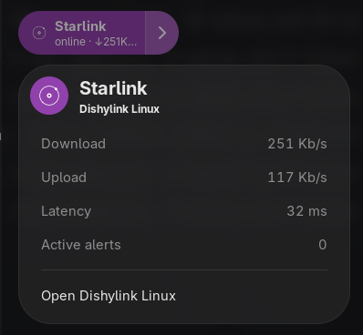

# Dishylink Linux

A native Linux app for monitoring your Starlink, written in Rust with GTK 4 and
libadwaita, with a GNOME Shell extension that puts your link's status in Quick
Settings.

Forked from [DaveyHert/Dishylink](https://github.com/DaveyHert/Dishylink).


It reads your dish and router directly over your local network, so it keeps
working during an outage, which is exactly when you want to see what happened.
History is recorded on your own machine. Signing in to your Starlink account is
optional. It adds plan and billing details and router controls that current
firmware only accepts through the account. The session is stored in your
desktop keyring (Secret Service) and is sent only to Starlink.

## Screens

| | |
| :-: | :-: |
| **Dashboard**: live throughput, latency, power, ping success, obstructions, events | **Satellite view**: 3-D obstruction dome, live constellation, time-lapse |
|  |  |
| **Data usage**: totals by period and per-device usage | **Network**: connected devices, mesh nodes, metering rules |
|  |  |
| **Alignment**: rotation and tilt against the dish's recommendation | **Speed test**: Starlink beam view and gauge |
|  |  |
| **Account**: optional Starlink sign-in | **Alerts**: active, history, status checks, events |
|  |  |
| **Settings → Starlink**: dish info, snow melt, sleep, updates, controls | **Settings → Router**: address, DNS, subnet, Wi-Fi password |
|  |  |
| **Settings → App**: language, toolbar, notifications, tray, Quick Settings pill | |
|  | |

Device names, addresses and IDs are blurred in the Network and Data usage
screenshots.

<details>
<summary>Light mode</summary>

| | |
| :-: | :-: |
|  |  |
|  |  |
|  |  |
|  |  |
|  |  |
|  | |

</details>

### GNOME Quick Settings pill

The extension shows whether the link is online, the live download and upload
rates, latency, and active alerts, and opens the app. It only reads the status
the app publishes on D-Bus (`com.dishylink.Status1` at
`/com/dishylink/app/Status`). It never talks to the dish or the router.



## Features

- **Dashboard**: stat tiles with sparklines and drill-downs; throughput, latency
  and power charts over 15 minutes, 1 hour or 6 hours; obstruction map; outage
  and event log with post-mortems; dish terminal view.
- **Always-on recording**: the recorder runs on its own thread, so closing the
  window doesn't stop it. It writes atomic JSON Lines files with torn-tail
  recovery, plus per-minute energy and latency, events, thermal readings and
  hourly obstruction snapshots.
- **Satellite view**: the obstruction dome rendered natively with OpenGL, the
  live constellation from the public CelesTrak catalogue (SGP4), the likely
  serving satellite highlighted, per-kit 3-D dish models, and a time-lapse of
  the sky survey.
- **Network**: router clients and mesh nodes, per-device usage with a
  billing-month odometer, and metering rules with allowances, countdowns and
  weekly timetables, per device or per group. Rules only announce; pausing or
  renaming a device is a separate, confirmed action.
- **Alerts**: an alert engine with 48-hour history, opt-in desktop
  notifications and an alert chime.
- **Settings**: dish and router controls (reboot, stow, factory reset, snow
  melt, sleep schedule, update window, DNS, subnet, Wi-Fi password). Every
  write is confirmed and sent exactly once.
- **Desktop integration**: single instance, a tray icon with a throughput
  readout, start at login, the Quick Settings pill, dark-glass and light themes,
  and five languages (English, Spanish, French, German, Portuguese).
- **Headless recorder**: `dishy record` runs the same recorder without a window,
  for example on a server or a Raspberry Pi.

## Downloads (0.1.0, testing)

This is an early, **testing** release. Expect rough edges and please report issues.

- **Latest Flatpak build**: download `dishylink-x86_64.flatpak` (or `dishylink.flatpak`)
  from the artifacts of the most recent successful **CI run** on `main`:
  https://github.com/neonyirenda/dishy-link-linux/actions/workflows/ci.yml
  (open the latest run, then the `dishylink-flatpak` artifact).
- **Tagged releases**: once a version is tagged, the Flatpak bundle is attached
  to the GitHub Release for that tag under
  https://github.com/neonyirenda/dishy-link-linux/releases
- Install with:
  ```sh
  flatpak install --user dishylink-x86_64.flatpak
  flatpak run com.dishylink.app
  ```

Pull requests and assistance are very welcome — open an issue or PR and I'll
look at it.

## Building

You need Rust 1.92 or newer and the GTK development packages.

Fedora:

```sh
sudo dnf install gtk4-devel libadwaita-devel webkitgtk6.0-devel libsecret
```

Debian or Ubuntu:

```sh
sudo apt install libgtk-4-dev libadwaita-1-dev libwebkitgtk-6.0-dev libsecret-tools
```

Then:

```sh
cargo run -p dishy-gtk --release           # the app: window, tray and recorder
cargo run -p dishy-gtk -- --hidden         # tray-only start (what autostart uses)
cargo run -p dishy-cli -- status           # one dish status reply as JSON
cargo run -p dishy-cli -- status --router  # the router's status
cargo run -p dishy-cli -- record           # headless recorder
cargo run -p dishy-cli -- record --once    # one poll, then exit
```

The app and `dishy record` share `~/.config/Dishylink/data`; only one of them
records at a time. Set `HISTORIAN_DATA_DIR`, or pass `--data-dir` to the CLI, to
record somewhere else.

Tests, as CI runs them:

```sh
cargo fmt --all -- --check
cargo clippy --workspace --all-targets -- -D warnings
cargo test --workspace
```

### Flatpak

Needs `flatpak-builder` and the GNOME 51 SDK with the rust-stable extension.

```sh
python3 packaging/linux/generate-cargo-sources.py   # after any Cargo.lock change
flatpak-builder --user --install --force-clean build-flatpak packaging/linux/com.dishylink.app.json
flatpak run com.dishylink.app
```

The Flatpak builds offline from the crates vendored in
`packaging/linux/cargo-sources.json`.

### GNOME Shell extension

Install it from **Settings → App → Quick Settings pill**, or by hand:

```sh
packaging/gnome-shell-extension/make-extension.sh
gnome-extensions install --force packaging/gnome-shell-extension/dishylink@dishylink.app.shell-extension.zip
# On Wayland, log out and back in, then:
gnome-extensions enable dishylink@dishylink.app
```

It supports GNOME Shell 46–51. The pill hides while the app isn't running. With
it installed, you can turn off **Settings → App → Show tray icon**.

## Network use

The dish answers at `192.168.100.1:9201` and the router at its LAN address on
port 9001, both in grpc-web over HTTP. The approved cadences are 5 s history,
2 s status and 30 s obstruction. The network page reads the client list
every 5 s and radio temperatures every 15 s, only while it is visible.
Dish settings are read only while Settings is visible, at most once a minute.
The app never calls the router's `get_ping`, which has rebooted it under load.
A test enforces this.

Beyond the dish, the router and your Starlink account, the app reaches three
public hosts, each only on demand:

- CelesTrak, for the satellite catalogue while the satellite view is open
- geojs, only when you press **Approximate from IP**
- Cloudflare, only during a speed test

Every reply is read with a 16 MiB cap.

## Repository layout

```
crates/
  dishy-proto/   protoset loading, request encoding, response decoding
  dishy-core/    grpc-web transport, device clients, polling, recording
  dishy-cloud/   starlink.com account and device gateway
  dishy-sky/     sky maths: survey, camera, vertex buffers
  dishy-cli/     headless recorder and diagnostics
  dishy-gtk/     the GTK app (translations in locales/)
packaging/
  linux/                    .desktop, AppStream, Flatpak manifest, vendored crates
  gnome-shell-extension/    the Quick Settings pill
specs/           requirements with IDs; each active one is cited by a test
docs/            screenshots
```

## License

MIT, unchanged from the original. See [LICENSE](LICENSE).

Dishylink Linux is an unofficial, independent project with no affiliation to
SpaceX or Starlink. Starlink is a trademark of Space Exploration Technologies
Corp.
